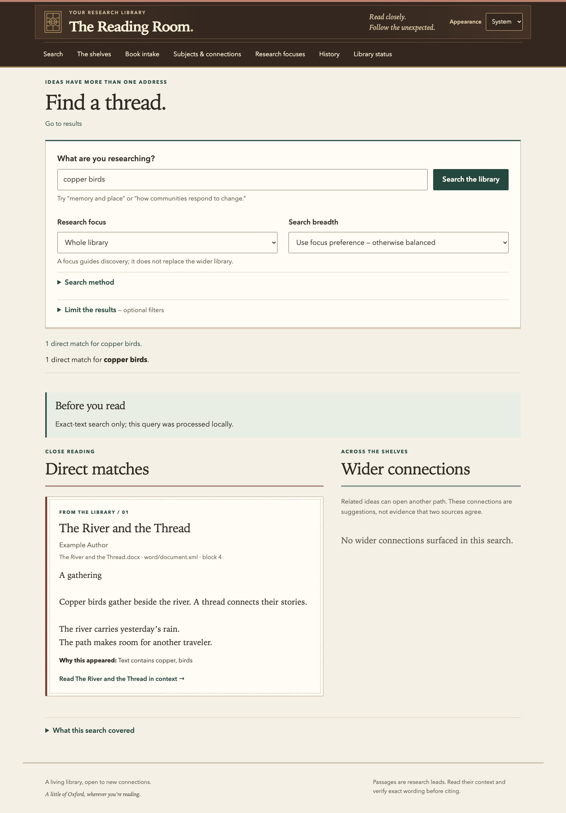

# Quickstart

The first run is local and requires no API key. You will build the interface, choose a folder for your books, and try a disposable demonstration before touching your own collection.

## 1. Check prerequisites

Use macOS with Git, Python 3.12, and a supported Node.js version available in your terminal. **Node 24.15.0 or newer within 24.x is recommended.** The locked frontend dependencies support Node **22.22.2+ within 22.x**, **24.15.0+ within 24.x**, or **26.0.0 and newer**; Node 23 and 25 are outside that range.

Check the versions:

```sh
git --version
python3.12 --version
node --version
npm --version
```

If a command is missing, install it first using the [Git download guidance](https://git-scm.com/downloads/mac), [Python downloads](https://www.python.org/downloads/macos/), or [Node.js downloads](https://nodejs.org/en/download). Setup reports missing or incompatible prerequisites; it does not silently install system software. The supported Python version for this preview is 3.12.

## 2. Clone and set up

```sh
git clone https://github.com/sethwilsonUS/reading-room.git
cd reading-room
./bin/setup
```

Setup creates a checkout-local `.venv`, installs locked dependencies, builds the browser interface, and asks where your book collection should live. Choose a folder outside this checkout. The default is `~/dev/books`; a different location is fine.

For an explicit location without an interactive prompt:

```sh
./bin/setup --root "$HOME/Books/ReadingRoom" --non-interactive
```

Setup stores the chosen path in ignored `.reading-room/local.json` and links the originals in [`skills/`](../skills/README.md) into ignored `.agents/skills` for Codex project discovery. User-wide skill installation remains optional. The books folder contains a private `.library` directory for settings, indexes, corrections, and history. Do not add these local-state directories to Git.

You do not need to activate the virtual environment for `./bin/library` commands. Running setup again preserves existing library records and settings. Setup does not start the server, install login startup, scan books, or enable paid features.

Check the result:

```sh
./bin/library doctor --json
```

Diagnostics identify missing dependencies, frontend assets, path problems, and configuration issues without displaying a key or making a paid request.

## 3. Explore the demo

```sh
./bin/library demo
```

Open the printed URL, normally [http://127.0.0.1:18768](http://127.0.0.1:18768). Search for **copper birds**, open a result, inspect its surrounding text, and open its citation. The prose and bibliographic information are invented examples, not quotations from a published book.

The results page should show one direct match from *The River and the Thread*, a notice that the query was processed locally, and a link to read the match in context. The screenshot below illustrates that state; all instructions also appear in text.



The demo uses a temporary, read-only library with paid features disabled, even if you have configured a key elsewhere. It supports search, reading, and citations; editing and review are disabled. Its temporary data disappears when it stops. Press **Control-C** to stop the server. If the port is occupied, choose another:

```sh
./bin/library demo --port 18769
```

## Add your first book

Use a local EPUB or DOCX you are authorized to use. Bookshare users can follow the [Codex workflow](codex.md#bookshare-workflow); manual downloads work too.

1. Keep the downloaded original. Place a byte-identical working copy in its own folder inside your chosen books directory.
2. Start the Reading Room in one terminal:

   ```sh
   ./bin/library serve
   ```

3. In another terminal, from the checkout, request local-only intake. Replace the example path with your actual book folder:

   ```sh
   ./bin/library intake --path "$HOME/Books/ReadingRoom/Example Book" --local-only --json
   ```

4. Open [http://127.0.0.1:18765](http://127.0.0.1:18765). Use **Intake** to check progress, then find the book on the shelves. Refresh explicitly to see updated progress.
5. Search for a distinctive phrase from the book, read it in context, and inspect the citation warnings.

The intake command returns an intake ID. It queues work for the running server; it is not a promise that every stage has finished. You can also inspect the queue from the terminal:

```sh
./bin/library intake status --json
./bin/library status --json
```

If you only need immediate exact indexing, `./bin/library sync --exact` indexes local text without authorizing AI review. Use intake when you want acquisition context and a tracked preparation workflow. See [acquisition and intake](intake.md) for split books, provenance, and review choices.

## Next steps

- [Install the Codex skills](codex.md) for agent-assisted research.
- [Enable optional AI features](ai-and-privacy.md) with your own API key and accepted spending limits.
- [Configure login startup](operations.md#start-at-login) after manual startup works.
- [Back up your library](operations.md#back-up-and-restore) before making substantial changes.

To stop a manually started server, return to its terminal and press **Control-C**. This does not delete your books or library records.
